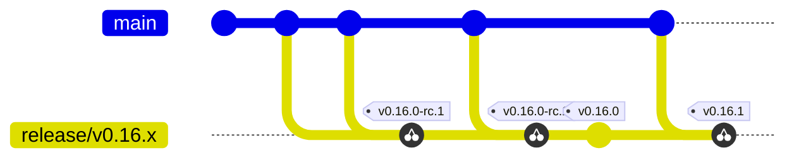

# NodeWright Release Process

Step-by-step process for releasing NodeWright components using **release branches**.

For where every component has been published over the project's history, including the frozen `skyhook` and NGC paths, see [Artifact Locations](../operations/artifact-locations.md).

## Release Branch Strategy

A release branch is cut from `main` when a line is ready to stabilize: the operator/chart line at feature-freeze, the agent and CLI lines when a minor or major of that component is ready (see the table below). All release candidates and the final release for that minor version are tagged on that branch, and every later patch for the same minor line is cherry-picked back to the same branch and tagged from there. The release branch is the single source of truth for everything that ships under one minor version — once it exists, nothing for that minor goes anywhere else.

There are three branch families, one per release cadence:

| Branch | Tags cut on it | Cut when |
| --- | --- | --- |
| `release/vX.Y.x` | `operator/vX.Y.*`, `chart/vX.Y.*` | The operator minor reaches feature-freeze. The chart defines the compatible set, so it always moves with the operator. |
| `release/agent/vX.Y.x` | `agent/vX.Y.*` | An agent minor or major is ready to ship, on its own schedule. |
| `release/cli/vX.Y.x` | `cli/vX.Y.*` | A CLI minor or major is ready to ship, on its own schedule. |

The agent gets its own family because it is versioned independently and its releases do not line up with the operator's: `agent/v7.0.0` (the Go rewrite) ships between operator minors, and neither forcing an early operator minor nor shipping a rewrite as a chart patch would have been honest. The operator and chart stay together on one branch because the chart's job is to pin a compatible set. The two families meet at the chart: a new agent version reaches users when the chart's agent pin is bumped, which is a normal chart patch on `release/vX.Y.x` (see [Agent Releases](#agent-releases)).

The CLI gets its own family for the same reason, and it never meets the chart at all: users install `kubectl nodewright` themselves, upgrade it on their own schedule, and run it against any supported operator version, so a CLI release is not tied to an operator minor and needs no chart patch to reach anyone (see [CLI Releases](#cli-releases)).

**Flow (one minor line):**



`X`, `Y`, `Z` are fixes that land on `main` first and get cherry-picked to `release/v0.16.x`. Each RC and the final release are tagged on that branch. Patches (`v0.16.1`, …) stay on the same release branch.

**Key principles:**

- **Branch first, then tag.** Always cut the release branch before the first RC. Tags only live on release branches, never on `main`: operator and chart tags on `release/vX.Y.x`, agent tags on `release/agent/vX.Y.x`, CLI tags on `release/cli/vX.Y.x`.
- **Cherry-pick from `main`.** Any fix or feature destined for a release lands on `main` first, then is cherry-picked to the release branch. The release branch is never the place to *develop* — only to *stabilize and ship*.
  - Rare exception: a change that is genuinely release-branch-only (e.g. a `chart/Chart.yaml` version bump for that line) can be committed directly to the release branch via a feature branch and PR.
- **RCs are the validation gate.** Cut `-rc.1`, `-rc.2`, … on the release branch until you're happy. When an RC is approved, tag the final with no code changes in between: only the release bookkeeping lands after the RC. For the operator, agent and CLI that is the changelog cut; for the chart it is the changelog cut together with the `Chart.yaml` version bump.
- **Patches stay on the same branch.** `v0.16.1`, `v0.16.2`, … are all cut from `release/v0.16.x` — cherry-pick the fix from `main`, bump `chart/Chart.yaml`, tag. Agent and CLI patches do the same on `release/agent/vX.Y.x` and `release/cli/vX.Y.x`, with the changelog cut in place of the chart bump.
- **Component naming:** Operator drives the `release/vX.Y.x` line; chart always gets tagged there because `Chart.yaml` (and therefore `appVersion`) moves with every release. The agent is tagged only on its own `release/agent/vX.Y.x` line, and a chart release picks up whichever agent version its `values.yaml` pins. The CLI is tagged only on its own `release/cli/vX.Y.x` line.
- **Branch protection and CI already know all three families.** `merge-gate.yaml` runs on pull requests into any branch, so a release branch of any family gets the same CI as `main` once it carries that workflow; a branch cut before it keeps the per-workflow triggers it was cut with. The repository's `release` ruleset uses fnmatch, where neither `*` nor a bare `**` crosses a `/`, so it lists `refs/heads/release/*`, `refs/heads/release/agent/*` and `refs/heads/release/cli/*` (`refs/heads/release/**/*` would also cover all three); agent and CLI release branches get the same deletion, force-push and pull-request rules.

### Major/Minor Release Workflow

The operator ships first and the chart follows it: the chart pins the operator image by digest, and that digest only exists once the operator tag has built. Three rules hold throughout:

- **Every change reaches the release branch through a pull request.** The `release` ruleset rejects direct pushes, so a cherry-pick or a release commit goes up as its own branch and a PR into `release/vX.Y.x`. Creating the release branch is the only direct push.
- **Release commits land on `main` first** and are cherry-picked over, like any fix. The changelog cuts and chart bumps below all follow that path.
- **Tags are made with `make release-tag`** from an up-to-date checkout of the release branch (see [Cutting a release tag](#cutting-a-release-tag-make-release-tag)). It tags `HEAD`, so check the branch and commit it prints before confirming, and push only once you have checked the tag.

Every step that moves a commit from `main` to the release branch uses the same recipe:

```bash
git fetch origin
git switch -c cherry-pick/<pr>-release-v0.21.x origin/release/v0.21.x
git cherry-pick -x -s -S <merge-sha-on-main>
git push -u origin HEAD
gh pr create --base release/v0.21.x --title "<original title> (#<pr>)"
```

1. **Cut the release branch** from `main` at feature freeze.

   ```bash
   git fetch origin
   git switch -c release/v0.21.x origin/main
   git push -u origin release/v0.21.x
   ```

2. **Tag the operator RC.** On `release/v0.21.x`, run `make release-tag` and choose operator, minor, release candidate. Pushing `operator/v0.21.0-rc.1` builds and publishes the image and a GitHub pre-release; `latest` does not move. Validate it by installing the current chart with the image overridden:

   ```bash
   --set controllerManager.manager.image.tag=v0.21.0-rc.1 \
   --set controllerManager.manager.image.digest=<index digest>
   ```

   Fixes land on `main` and are cherry-picked over; tag `-rc.2`, `-rc.3`, … until clean.

3. **Cut the operator changelog** on `main` with `scripts/gen-changelog.sh operator v0.21.0`. It adds the `[operator/v0.21.0]` section to `operator/CHANGELOG.md` and promotes `## Unreleased` in `operator/RELEASE_NOTES.md` to `## operator/v0.21.0 - <date>`, the heading the release page takes its notes from. The script stamps `RELEASE_NOTES.md` with the local date and `CHANGELOG.md` with the UTC date, so align them if they differ. Open it as a PR to `main`, then cherry-pick it over.

   A minor cut lists every commit since the previous final tag that is reachable from `HEAD`, so cutting on `main` is only right while `main` carries no commits for the component that the release branch lacks. Check before cutting:

   ```bash
   git fetch origin
   git log --oneline --cherry-pick --right-only origin/release/v0.21.x...origin/main -- operator/
   ```

   The three dots and `--cherry-pick` matter: a cherry-pick gets a new commit id, so a plain `release..main` range lists every fix already backported as if it were missing. If the check prints anything, cut on a branch off `origin/release/v0.21.x` instead and PR it into the release branch. Then, on `main`, move the notes that shipped from `## Unreleased` to a matching `## operator/v0.21.0 - <date>` heading in a separate PR, so the next minor does not publish them again.

4. **Tag the operator final** on the merged cherry-pick: `make release-tag`, operator, minor, not a release candidate. The code is the last RC's and only the changelog differs, but the image is rebuilt from the new commit, so its digest differs from the RC's. `latest` moves to it.

5. **Pin the operator in the chart and tag the chart RC.** Once the operator release has published, read its index digest:

   ```bash
   crane digest ghcr.io/nvidia/nodewright/operator:v0.21.0
   ```

   On `main`, set `controllerManager.manager.image.tag` and `digest` in `chart/values.yaml` to that release (and the agent pin under `controllerManager.manager.agent`, if this line ships a new agent), and set `chart/Chart.yaml` to `version: v0.21.0-rc.1` and `appVersion: v0.21.0`. `appVersion` names the operator the chart ships, so it carries no `-rc` suffix when that operator is final. PR it to `main`, cherry-pick it over, and tag `chart/v0.21.0-rc.1` with `make release-tag` (chart, minor, release candidate). The release workflow fails if the tag does not match `Chart.yaml` `version`. Validate with `helm install ... --version v0.21.0-rc.1`.

   Every chart version, RCs included, stays in the NGC Helm repository permanently: NGC does not allow chart versions to be deleted.

6. **Cut the chart final.** On `main`, run `scripts/gen-changelog.sh chart v0.21.0` and set `chart/Chart.yaml` `version: v0.21.0`, in one PR, after the same check as step 3 with `chart/` as the path. Cherry-pick it over and tag `chart/v0.21.0`.

**Automated:** Tests → Multi-platform build → Publish to `ghcr.io` → Copy to NGC staging

A `chart/v*` tag push also publishes the Helm chart as an OCI artifact to `oci://ghcr.io/nvidia/nodewright/charts/nodewright`. Consumers install with:

```bash
helm install nodewright oci://ghcr.io/nvidia/nodewright/charts/nodewright --version v0.16.0
```

The packaged chart carries the Apache-2.0 `LICENSE` and `NOTICE`. `chart/LICENSE` and `chart/NOTICE` are copies of the root files, kept identical by `make chart-license-check` in Lint CI, so edit the root file and copy it into `chart/`. Release branches cut before #720 have no `NOTICE`; to include it in a chart patch from such a branch, cherry-pick the root `NOTICE` and `chart/NOTICE` along with the `chart-license-check` target (#729).

### Distribution: ghcr.io, staged to NGC

Starting with `v0.16.0`, users install NodeWright from GitHub Container Registry (`ghcr.io`):

| Artifact | Location |
| --- | --- |
| Operator image | `ghcr.io/nvidia/nodewright/operator` |
| Agent image | `ghcr.io/nvidia/nodewright/agent` |
| Helm chart (OCI) | `oci://ghcr.io/nvidia/nodewright/charts/nodewright` |

`v0.16.0` is the **first release using OCI on `ghcr.io` for the Helm chart** — previously the chart was published to the NGC Helm repository (`https://helm.ngc.nvidia.com/nvidia/skyhook`). The OCI distribution removes the `helm repo add` step entirely; Helm 3.8+ pulls from `oci://` URLs directly.

Every `operator/*`, `agent/*`, `chart/*`, and `cli/*` tag cut from a commit that carries the NGC jobs also stages its artifact in NGC. NVIDIA's internal release process promotes it from there to the public `nvcr.io/nvidia` catalog; that promotion is not part of these workflows.

| Artifact | NGC staging location |
| --- | --- |
| Operator image | `nvcr.io/1070195845945670/nodewright/operator` |
| Agent image | `nvcr.io/1070195845945670/nodewright/agent` |
| Helm chart (OCI) | `nvcr.io/1070195845945670/nodewright/nodewright` |
| Helm chart (Helm repository) | `1070195845945670/nodewright/nodewright` (NGC Helm repository) |
| CLI | `nvcr.io/1070195845945670/nodewright/cli` |

- **Images and the CLI are copied with their evidence, not rebuilt or re-signed.** The `publish-ngc` job in each of `operator-ci.yaml`, `agent-ci.yaml` and `cli-release.yaml` copies the released index from `ghcr.io` with `oras cp -r`, which brings the signature and every attestation along, including the SBOM and VEX on each platform manifest. It fails if the NGC index digest differs from the GHCR one, so the chart's digest pins hold for either registry, then verifies the copy. The evidence is the same signed material on both registries, and the commands under [Verify release signatures and attestations](#verify-release-signatures-and-attestations) work with `IMAGE` set to the NGC path. The `latest` tag is not moved in NGC staging.
- **The chart is staged twice.** The `publish-chart-ngc` job copies the OCI chart from `ghcr.io` with `oras cp -r`, like the images, so it keeps the same digest and carries the same signature, SBOM and provenance; the job fails if the NGC digest differs from the GHCR one, then verifies the copy. It then uploads the same package bytes to the NGC Helm repository with the NGC CLI. That repository is not an OCI registry, so the chart there carries no cosign signature; its SLSA provenance is a GitHub attestation on the package file, checked with `gh attestation verify nodewright-<version>.tgz --repo NVIDIA/nodewright`.
- **The NGC credential is confined to release refs.** The NGC jobs run in the `ngc-publish` GitHub environment. It holds the `NGC_API_KEY` secret, and its deployment policy admits the `operator/*`, `agent/*`, `chart/*` and `cli/*` tags plus the `release/*`, `release/agent/*` and `release/cli/*` branches. The branches are there only for the NGC job of `vex-reattest.yaml` (see [Correcting VEX on a released image](#correcting-vex-on-a-released-image)), and the environment's required-reviewer approval gates every run. Each NGC job runs after the GHCR publish and separately from it, so a failed NGC upload leaves the GHCR release intact and can be re-run on its own.

The chart's image-pull defaults in `chart/values.yaml` point at `ghcr.io`. Every location an artifact has been published to over the project's history, including the frozen `skyhook` paths, is listed in [Artifact Locations](../operations/artifact-locations.md).

### Release Candidate Tag Format

Only two tag shapes are accepted by the release workflow per component:

- `<component>/v<MAJOR>.<MINOR>.<PATCH>` — final release
- `<component>/v<MAJOR>.<MINOR>.<PATCH>-rc.<N>` — release candidate, published as a GitHub pre-release

The dot in `-rc.<N>` is required: it makes `git tag --sort=v:refname` order pre-releases correctly and matches the SemVer pre-release convention. Any other suffix (`-beta`, `-alpha`, `-rc<N>` without the dot, `-rc.1a`, etc.) is rejected by `.github/workflows/release.yml` so the tag format stays predictable.

Notes:

- Helm OCI accepts pre-release versions, so `chart/v0.16.0-rc.1` pushes `nodewright-v0.16.0-rc.1.tgz` to `oci://ghcr.io/nvidia/nodewright/charts`. Install with `--version v0.16.0-rc.1`.
- An operator or agent tag always publishes its version and commit-SHA image tags, but `latest` moves only if the tag is that component's newest stable tag when the image is published. An RC, a patch on an older release line, or a re-run for a superseded release leaves `latest` where it is. A tag cut from a release branch that predates this check still moves `latest` unconditionally; see [Patch Release Workflow](#patch-release-workflow).
- Release-notes scoping is asymmetric (see #246). A **stable** release's notes cover everything since the previous **stable** tag (rc tags are excluded as boundaries), so the stable release page is complete even after several RCs. An **RC**'s notes cover only the delta since the prior tag, which is what you want while iterating.

### Patch Release Workflow

Patches stay on the existing release branch and follow the same rules as a minor: every change arrives through a pull request, the operator is tagged before the chart that pins it, and tags come from `make release-tag`.

A release branch cut before the `latest` check (#631) moves `:latest` to every operator or agent tag cut from it, including a patch to an older line after a newer minor has shipped. Cherry-pick that change onto the branch before tagging such a patch.

Likewise, a release branch cut before NGC staging (#895) has no NGC jobs, so its tags publish to `ghcr.io` only. Cherry-pick that change onto the branch before tagging a patch that should reach NGC.

The CLI has the same gap for its OCI artifact: a `release/cli/*` branch cut before CLI OCI publishing (#763), such as `release/cli/v0.5.x`, publishes archives on the GitHub Release only. Cherry-pick that change onto the branch before tagging a CLI patch, so the patch also reaches `ghcr.io/nvidia/nodewright/cli` and NGC staging.

1. **Land the fix on `main`** as a normal PR, so it also ships in the next minor, then cherry-pick it to `release/v0.21.x` with the recipe in [Major/Minor Release Workflow](#majorminor-release-workflow).

2. **Cut the operator changelog on the release branch**, if the operator changed. A patch cut promotes `RELEASE_NOTES.md` only when the checked-out branch is `release/v0.21.x` itself (see [Where a cut section is sourced from](#where-a-cut-section-is-sourced-from-patch-vs-minor)), so run it there and carry the uncommitted result to a new branch for the PR:

   ```bash
   git fetch origin
   git switch release/v0.21.x && git merge --ff-only origin/release/v0.21.x
   scripts/gen-changelog.sh operator v0.21.1
   git switch -c chore/changelog-operator-v0.21.1
   git commit -s -S -am "chore(changelog): cut operator v0.21.1"
   git push -u origin HEAD
   gh pr create --base release/v0.21.x
   ```

   `main` picks the section up the next time its changelog is regenerated.

3. **Tag the operator patch** on the merged commit: `make release-tag`, operator, patch.

4. **Pin it in the chart and tag the chart patch.** Once the operator release has published, set its tag and index digest in `chart/values.yaml` and bump `chart/Chart.yaml` to `version: v0.21.1` and `appVersion: v0.21.1`. Make that change on `main` and cherry-pick it over, unless `main` already pins a newer operator; then PR it straight into the release branch (see [Release-Branch-Only Changes](#release-branch-only-changes-rare)). Tag `chart/v0.21.1` on the merged commit.

A chart-only patch skips steps 2 and 3, and bumps only `Chart.yaml` `version`; `appVersion` stays on the operator the chart pins.

Never tag the agent or the CLI here. An agent fix ships from `release/agent/vX.Y.x` (see [Agent Releases](#agent-releases)) and reaches this line as a `values.yaml` pin bump; the CLI ships from `release/cli/vX.Y.x`.

If the fix is urgent enough to need its own RC cycle, tag `operator/v0.21.1-rc.1` first and validate it as in the minor workflow before tagging `v0.21.1`.

### Agent Releases

The agent releases on its own branch family, `release/agent/vX.Y.x`, and reaches users through a chart patch that bumps the agent pin. The two steps are deliberately separate: the agent tag proves the image, the chart tag decides who gets it.

```bash
# 1. Cut the agent release branch from main when the agent minor/major is ready.
git fetch origin
git branch release/agent/v7.0.x origin/main
git push -u origin release/agent/v7.0.x

# 2. Tag the RC on that branch and push it. This publishes agent:v7.0.0-rc.1
#    (signed, with per-platform SBOM and VEX attestations) and a GitHub
#    pre-release; `latest` does not move for an RC.
git tag agent/v7.0.0-rc.1 release/agent/v7.0.x
git push origin agent/v7.0.0-rc.1

# 3. Validate the RC against a real cluster. Point a NodeWright's package at it
#    with `agentImageOverride`, or install a chart with the pin overridden:
#    --set controllerManager.manager.agent.tag=v7.0.0-rc.1 \
#    --set controllerManager.manager.agent.digest=<index digest>
#    Fixes land on main first and are cherry-picked to release/agent/v7.0.x;
#    tag -rc.2, -rc.3, ... until clean.

# 4. Cut the final. No code changes land after the last good RC; the only
#    commit between it and the final tag is the changelog cut, which does not
#    change the code: run `scripts/gen-changelog.sh agent v7.0.0` on main to cut
#    the CHANGELOG section and promote RELEASE_NOTES.md to the `## agent/v7.0.0`
#    heading release.yml prepends to the release body, PR it, cherry-pick it to
#    release/agent/v7.0.x through a PR (as #767 and #768 did), then tag the
#    merged commit. Run the main check from step 3 of the minor workflow first,
#    with agent/ as the path.
git fetch origin
git tag agent/v7.0.0 origin/release/agent/v7.0.x
git push origin agent/v7.0.0

# 5. Ship it in a chart. On main, bump the agent tag/digest under
#    controllerManager.manager.agent in chart/values.yaml together with the
#    chart/Chart.yaml version, cherry-pick that to the active operator/chart
#    line through a PR, and tag the chart patch on the merged commit, as in
#    step 4 of the Patch Release Workflow.
```

Agent patches (`agent/v7.0.1`, ...) follow the same shape as operator patches: cherry-pick the fix from `main` onto `release/agent/v7.0.x`, cut the changelog section there, tag there, then bump the chart pin on `main` and cherry-pick that to the chart line.

### CLI Releases

The CLI releases on its own branch family, `release/cli/vX.Y.x`, the same way the agent does, minus the chart step: a `cli/v*` tag push runs `.github/workflows/cli-release.yaml`, which builds the `kubectl-nodewright` binaries, pushes them to `ghcr.io/nvidia/nodewright/cli:<version>` as a signed OCI artifact index (see [Verify release signatures and attestations](#verify-release-signatures-and-attestations)), and publishes the same binaries as archives on the GitHub Release. Two jobs follow the verified OCI push and run independently of each other: one copies the index to NGC staging, the other creates the GitHub Release. The GitHub Release waits for the OCI artifact because its notes point at it, and it also checks that an anonymous client can read the artifact; if either fails there is no GitHub Release until the failed jobs are re-run. GHCR creates `ghcr.io/nvidia/nodewright/cli` as a private package on its first push, so before the first CLI release on OCI, or right after its GitHub Release job fails on that check, a package admin sets the package's visibility to public under its package settings, then re-runs the failed jobs. `latest` on that repository moves only for the newest stable release. Users install from either; `scripts/install-cli.sh` reads the OCI artifact.

```bash
# 1. Cut the CLI release branch from main when the CLI minor/major is ready.
git fetch origin
git switch -c release/cli/v0.5.x origin/main
git push -u origin release/cli/v0.5.x

# 2. Tag the RC on that branch and push it. This publishes a GitHub pre-release.
git tag cli/v0.5.0-rc.1 release/cli/v0.5.x
git push origin cli/v0.5.0-rc.1

# 3. Validate the RC against the operator versions the compatibility matrix in
#    docs/user-guide/cli.md claims to support. Fixes land on main first and are
#    cherry-picked to release/cli/v0.5.x; tag -rc.2, -rc.3, ... until clean.

# 4. Cut the final. The only commit between the last good RC and the final tag
#    is the changelog cut: run `scripts/gen-changelog.sh cli v0.5.0` on main,
#    PR it, and cherry-pick it into release/cli/v0.5.x through a PR (the release
#    ruleset rejects a direct push). Run the main check from step 3 of the minor
#    workflow first, with operator/cmd/cli/ as the path. Once the cherry-pick
#    merges, tag the merged commit.
git fetch origin
git tag cli/v0.5.0 origin/release/cli/v0.5.x
git push origin cli/v0.5.0
```

CLI patches (`cli/v0.5.1`, ...) follow the same shape: cherry-pick the fix from `main` onto `release/cli/v0.5.x`, land the changelog cut there through a PR, and tag the merged commit.

### Release-Branch-Only Changes (rare)

If a change genuinely doesn't belong on `main` — for example, the `chart/Chart.yaml` version bump for `v0.16.1`, or a backport that doesn't apply cleanly and needs to be re-implemented for the older line — open it as a feature branch off the release branch and PR it back to the release branch. **Default to cherry-picking from `main` first; only diverge when there's a clear reason the change can't exist there.**

## Changelogs and Release Notes

Each component keeps two files side by side:

| File | Owner | Contents |
| --- | --- | --- |
| `CHANGELOG.md` | machine-generated | every release and commit, derived from git history |
| `RELEASE_NOTES.md` | human-authored | behavior changes, breaking changes, upgrade steps, highlights |

`CHANGELOG.md` carries a `DO NOT EDIT` banner and is regenerated by `scripts/gen-changelog.sh`. **Never hand-edit it**; put curated prose in the sibling `RELEASE_NOTES.md` instead (organized by `## <component>/<version>` headings that match the changelog). Files: `operator/{CHANGELOG,RELEASE_NOTES}.md`, `chart/…`, `agent/…`, `operator/cmd/cli/…`.

### Attribution: committed changelogs vs. GitHub Release notes

Both are rendered by git-cliff from the same `cliff.toml`, but they are rendered differently on purpose:

| | Rendered by | GitHub API | Bullet looks like |
| --- | --- | --- | --- |
| Committed `CHANGELOG.md` | `scripts/gen-changelog.sh` (passes `--offline`) | not called | `- *(operator)* Fix the thing` |
| GitHub Release notes | `.github/workflows/release.yml`, `.github/workflows/cli-release.yaml` | called, with `GITHUB_TOKEN` | `- *(operator)* Fix the thing by [@user](…) in [#472](…)` |

The `by [@user] in [#N]` suffixes come from `commit.remote.username` and `commit.remote.pr_number`, which only git-cliff's GitHub integration populates. `--offline` disables that integration, so the same template clauses render as nothing in the committed files. Release notes are where credit belongs and are read by people who want the discussion behind a line; a committed changelog is a flat historical record and would churn on every regeneration if it embedded API-resolved data.

Consequences worth knowing:

- **Previewing with `scripts/gen-changelog.sh <component>` shows the uncredited form.** That is the committed-changelog rendering, not what the release page will say. To preview the credited form, run the workflow's own command with a token: `GITHUB_TOKEN=$(gh auth token) git cliff --include-path 'operator/**' --tag-pattern 'operator/v[0-9]+\.[0-9]+\.[0-9]+$' --tag <tag> <prev>..<tag> --strip all`.
- **Bot authors are named but not linked.** The GitHub API reports bot logins with a bracketed suffix (`dependabot[bot]`, `github-actions[bot]`), and `https://github.com/dependabot[bot]` is a 404 — there is no profile page at that address. The template renders those as plain `@dependabot[bot]` text and links only human contributors.
- **The PR link resolves only when the commit is the PR's merge commit.** Squash merges (this repo's normal path) resolve; an intermediate commit from a merge-commit-style PR, or a cherry-pick onto a release branch, gets author credit but no PR link. git-cliff matches on commit SHA, and there is no SHA to match on in those cases.
- **Attribution is best-effort and never blocks a release.** git-cliff panics rather than degrading when the API is unavailable, so both workflows wrap the call: on failure or a 5-minute timeout they log a `::warning::` and re-render with `--offline`, producing uncredited notes instead of a failed release.
- The `[remote.github]` block in `cliff.toml` pins the repo git-cliff resolves against, so resolution does not depend on how the runner's `origin` remote happens to be spelled.
- **Already-published releases are not backfilled.** Attribution starts with the first tag pushed after this landed. A published release page is a point-in-time artifact, and rewriting the older bodies would notify every watcher of the repo for content they have already read.

#### Why a script instead of plain `git-cliff`

A single `git-cliff --include-path <c>/** --tag-pattern <c>/.*` call silently drops most release sections in this monorepo: git-cliff path-filters commits first, then looks for tags only among survivors, so a tag whose commit touches no files under the component path (a chart bump, a CI fix, a ride-along agent release) is orphaned, and release-branch-only tags are invisible from `main`. `gen-changelog.sh` takes the release boundaries from `git tag` and renders each section over an explicit `prevTag..curTag` range, which avoids all of that. (Background: orhun/git-cliff#1122, #208.)

### Writing and promoting a release note

Write notes as you go, under the `## Unreleased` heading at the top of the component's `RELEASE_NOTES.md`. You do not name the version: **cutting the release promotes the heading for you.** `scripts/gen-changelog.sh <component> vX.Y.Z` renames `## Unreleased` to `## <component>/vX.Y.Z - <date>` and opens a fresh empty `## Unreleased` above it.

That promotion is what makes the notes reachable. The release workflows extract the release body by matching a heading that is exactly `## <tag>`; `## Unreleased` matches nothing, and an empty match is indistinguishable from the (common, legitimate) case of a release with no hand-authored notes, so unpromoted notes are dropped silently.

Details worth knowing:

- **An empty `## Unreleased` promotes to nothing.** Most releases have no hand-authored notes and should not gain a stub heading.
- **Re-running a cut is safe.** If the target `## <component>/vX.Y.Z` heading already exists, the script warns and leaves both it and `## Unreleased` alone.
- **Patches only promote on their release branch.** See below.
- **`make release-tag` warns** if you are about to tag a final version while `## Unreleased` still holds content and no section for that tag exists.

### Commands

```bash
# Regenerate a CHANGELOG.md (interactive: prompts for component + action).
make changelog

# Non-interactive forms (used by CI and release-tag.sh):
scripts/gen-changelog.sh <operator|agent|chart|cli>            # regenerate ([Unreleased])
scripts/gen-changelog.sh <operator|agent|chart|cli> v0.2.0     # cut a release section
for c in operator agent chart cli; do scripts/gen-changelog.sh "$c"; done   # bulk refresh

# Interactively cut a release TAG (see below).
make release-tag
```

### Where a cut section is sourced from (patch vs. minor)

When you cut a **patch** (`vX.Y.Z` whose `X.Y` already has a final tag), the new section is sourced from that line's release branch, `release/vX.Y.x` (or `release/agent/vX.Y.x` for the agent), not from your current `HEAD`. A patch ships only the fixes cherry-picked onto its release branch; `main` meanwhile carries unrelated work bound for the next minor (a breaking API change, a dependency bump, …), and ranging `prevTag..HEAD` on `main` would sweep all of that into the patch. Sourcing from the release branch gives exactly what the patch ships, and lets you run the generator from any branch.

Practical consequences for a patch cut:

- The release branch must already exist and already carry the cherry-picks. Order is: cherry-pick the fix onto `release/vX.Y.x` first, then run the generator. The generator prints `Patch cut: sourcing <c>/vX.Y.Z from release/vX.Y.x (...)` so you can see the source it chose.
- If `release/vX.Y.x` (or `origin/release/vX.Y.x`) doesn't exist, it errors and tells you to create the branch and cherry-pick first.
- If nothing new is on the release branch since the previous tag, it warns (`no <c> commits for vX.Y.Z ... cherry-picked onto ... yet?`) rather than emitting an empty section: the usual cause is forgetting the cherry-pick.
- **`RELEASE_NOTES.md` is only promoted when you run the cut from `release/vX.Y.x` itself.** Unlike `CHANGELOG.md`, it is read from your working tree, not from the release branch. On the release branch its `## Unreleased` block is exactly the notes for the cherry-picks the patch ships; on `main` it is the *next minor's* notes, and promoting that would file them under a patch. Cutting a patch from anywhere else regenerates the CHANGELOG as normal and leaves `RELEASE_NOTES.md` untouched with a warning naming the branch to re-run from.

A **minor or major** (`vX.Y.0`, no prior tag on that `X.Y`) has no backport branch to read from, so it walks commits after the latest tag from `HEAD`. That is why the minor workflow cuts it on `main` only after checking that `main` carries nothing for the component beyond the release branch (see step 3 of [Major/Minor Release Workflow](#majorminor-release-workflow)).

### Cutting a release tag (`make release-tag`)

`scripts/gen-changelog.sh` writes changelogs; `scripts/release-tag.sh` (via `make release-tag`) creates the git tag. They are separate steps. The tag helper:

1. Prompts for a component and a bump (major/minor/patch).
2. Offers a release candidate; if chosen, it computes the next `-rc.N` for that version automatically.
3. Shows the resulting `<component>/<version>` tag and the commit it will sit on, and creates it only after a `y/N` confirm.
4. Offers, as a **separate** `y/N`, to `git push` the tag. Pushing is what triggers the CI release, so it is always a distinct, opt-in step; the default is no.

The tag is created on the current `HEAD`. It does **not** edit `CHANGELOG.md`, promote `RELEASE_NOTES.md`, or bump `chart/Chart.yaml` for you: do the release commit first (bump `Chart.yaml`, cut the CHANGELOG with `make changelog` — which also promotes the `RELEASE_NOTES.md` heading — then commit), then run `make release-tag` so the tag points at that commit. The two y/N confirms (create, then push) are the safety gate; there is no separate dry-run.

Before the first confirm it also warns when the component's `RELEASE_NOTES.md` still has content under `## Unreleased` and carries no section for the tag you are about to create — the signature of tagging without having cut the changelog. It is a warning, not a block: RC tags are exempt (an RC is tagged mid-stabilization, before the cut that promotes the heading), and a release may legitimately have no hand-authored notes at all.

### How the GitHub release body is assembled

On a `<component>/v*` tag push, the release workflow builds the release body from the commit-level range for that version (see the asymmetric RC scoping above) and **prepends the matching `## <component>/<version>` entry from `RELEASE_NOTES.md`** if one exists. The match is exact: a heading that is precisely `## <tag>` or `## <tag> <suffix>`. That heading is produced by the release cut (see [Writing and promoting a release note](#writing-and-promoting-a-release-note)); notes left under `## Unreleased` match nothing and are dropped without an error.

### Tag placement

Where possible, place a release tag on a commit that touches the component's own path (the `release:` changelog-bump commit does). The generator no longer *requires* it (it anchors on `git tag`, not the commit), but it keeps history tidy.

## Release Checklist

**Before cutting the release branch (minor / major):**

- [ ] All target features/fixes merged to `main`
- [ ] Tests passing on `main`
- [ ] Documentation updated on `main`
- [ ] For the operator or agent, `make vuln-status` shows `main` clean for that component. This makes a blocked RC unlikely, not impossible: the RC tag's [release gate](#the-release-gate) scans the RC's own images, on every platform, against that day's vulnerability database. The CLI is built only from tags, so it has no `main` row, and its RC's gate is the first check.

**Before each operator tag:**

- [ ] All intended cherry-picks from `main` have merged into the release branch
- [ ] CI is green on the release branch
- [ ] For a final: the changelog cut has merged into the release branch, so `operator/RELEASE_NOTES.md` carries the `## operator/vX.Y.Z` heading when there are notes (`make release-tag` warns when it does not)
- [ ] For a final: nothing has changed since the validated RC except the changelog cut

**Before each chart tag:**

- [ ] The operator release the chart pins has finished publishing
- [ ] `chart/values.yaml` pins that operator's tag and index digest, and the agent this line ships
- [ ] `chart/Chart.yaml` `version` matches the chart tag, including any `-rc.N`, and `appVersion` is the operator version the chart pins
- [ ] For a final: the chart changelog cut has merged into the release branch, and nothing else has changed since the validated chart RC

**After tagging:**

- [ ] CI/CD pipeline completes
- [ ] Images and chart artifacts published successfully
- [ ] NGC staging jobs (`publish-ngc`, `publish-chart-ngc`) succeeded
- [ ] Test deployment with new version
- [ ] For a final, its row added to the [release archive](releases.md)

### Pin multi-arch image digests in the chart

The chart references images by tag and digest, so a release is reproducible across architectures. Always pin the multi-arch index (manifest list) digest, never a single-platform child.

For the operator and agent, pin the index digest of the release the chart ships, once that release has finished publishing:

```bash
crane digest ghcr.io/nvidia/nodewright/operator:v0.21.0
crane digest ghcr.io/nvidia/nodewright/agent:v7.0.0
```

The NGC staging copies have the same digests, because they are byte-identical copies of the GHCR releases.

For a third-party image, use skopeo:

- skopeo (`skopeo --version`)
- jq (`jq --version`)

Fetch the multi-arch (manifest list) digest (example for alpine/kubectl, used by the cleanup pre-delete jobs and the selector-migration pre-upgrade hook). The digest to pin is the sha256 of the raw manifest list:

```bash
skopeo inspect --raw docker://docker.io/alpine/kubectl:1.36.2 | skopeo manifest-digest /dev/stdin
# sha256:01d138ce994b684abc62d9cfdff44de42a4c8996dcc12626dd0193afc3fb5a95
# pin that value (including the sha256: prefix) in chart/values.yaml
```

Confirm it is a manifest list covering the platforms we ship (at least amd64 + arm64):

```bash
skopeo inspect --raw docker://docker.io/alpine/kubectl:1.36.2 \
  | jq -r '.manifests[].platform | "\(.os)/\(.architecture)"'
```

`alpine/kubectl` is a maintained, versioned, multi-arch image. These short-lived maintenance jobs only run `kubectl get`/`delete` on stable core/apps resources, where kubectl's version skew is a cosmetic warning rather than a functional break, so the tag tracks a recent maintained release for current base-image fixes. Bump it as the image is maintained.

The maintenance-job kubectl image is pinned with `webhook.removalImage`, `removalTag` and `removalDigest` in `chart/values.yaml`. `skopeo inspect --raw` returns the manifest list itself, so `manifest-digest` of that output is the list digest.

### Verify release signatures and attestations

Release workflows publish keyless Sigstore signatures, CycloneDX SBOM attestations, and SLSA v1 provenance attestations for GHCR image, CLI and Helm chart release artifacts, and for the images, CLI artifact and OCI Helm chart staged in NGC. Container images and the CLI additionally carry an OpenVEX attestation.

Prerequisites:

- cosign v3 (`cosign version`); the release workflows install v3.1.3
- crane (`crane version`), or Docker buildx (`docker buildx version`)
- jq (`jq --version`)

These commands assume cosign v3, where `--new-bundle-format` already defaults to `true`. On an older cosign, add `--new-bundle-format=true` to every `verify` and `verify-attestation` call below, or upgrade; the signing side passes it explicitly, so a default mismatch surfaces as a missing attestation rather than as a format error.

Do not filter attestations by the `dev.sigstore.bundle.predicateType` referrer annotation on artifacts released before the v3.1.3 pin. cosign through v3.0.6 wrote that annotation as `https://sigstore.dev/cosign/sign/v1` on every attestation regardless of `--type`, so on those tags a CycloneDX SBOM and a cosign signature are indistinguishable by annotation. The signed in-toto statement always carried the correct predicate type, so the `verify-attestation --type` commands below were never affected: they decode the payload rather than reading the annotation. Artifacts released from the v3.1.3 pin onward annotate correctly, and the ones before it are not re-signed.

#### Which digest carries which evidence

The operator and agent images are multi-platform: the tag resolves to an index, and the index has one platform manifest per architecture (`linux/amd64`, `linux/arm64`). Evidence is attached to the subject it is true about, so the image evidence is split across two kinds of digest:

| Evidence | Subject | Predicate type |
|---|---|---|
| Signature | Index digest | n/a (`cosign verify`) |
| SLSA build provenance | Index digest | `https://slsa.dev/provenance/v1` |
| CycloneDX SBOM | Each platform manifest digest | `cyclonedx` |
| OpenVEX | Each platform manifest digest | `openvex` |

A signature and a provenance statement describe the artifact as a whole, and the index is what a user pulls, so they stay on the index. An SBOM and a VEX document each describe exactly one root filesystem, and the amd64 and arm64 images do not share one, so an SBOM on the index would describe neither child truthfully. This is the same subject policy the signing action documents in `.github/actions/cosign-attest-multiplatform/action.yml`.

The consequence for anyone verifying a release: **the signature does not verify against a platform digest, and the SBOM is not found on the index digest.** Both are expected. Resolve both kinds of digest and point each check at the right one.

The OpenVEX document may legitimately contain zero statements. An empty `statements` array asserts that the maintainers claim no exceptions to what a scanner reports; it does not assert the image is clean. The reasoning, and why an empty projection is still worth publishing, is in the header of `.github/actions/cosign-attest-multiplatform/action.yml`.

#### Resolving digests

With crane:

```bash
IMAGE=ghcr.io/nvidia/nodewright/operator
TAG=v0.19.0

INDEX=$(crane digest "${IMAGE}:${TAG}")
AMD64=$(crane digest --platform linux/amd64 "${IMAGE}@${INDEX}")
ARM64=$(crane digest --platform linux/arm64 "${IMAGE}@${INDEX}")
```

Resolve the tag **once**, then resolve the platforms from `${IMAGE}@${INDEX}` rather than reading the tag again. A tag can be repointed between two calls, and a verification that resolves it twice can check a signature against one index and an SBOM against a child of another, passing every check while describing two different artifacts. `.github/actions/cosign-attest-multiplatform/action.yml` resolves platforms from the index digest for the same reason.

Without crane, Docker buildx resolves the same values. The index digest:

```bash
INDEX=$(docker buildx imagetools inspect "${IMAGE}:${TAG}" --format '{{json .Manifest}}' | jq -r '.digest')
```

The platform manifest digests are listed under `Manifests:` in the plain `docker buildx imagetools inspect "${IMAGE}@${INDEX}"` output, one entry per `Platform:`; take the `Name:` digest of the platform you want. For scripting, read them out of the raw index:

```bash
AMD64=$(docker buildx imagetools inspect --raw "${IMAGE}@${INDEX}" \
  | jq -r '.manifests[] | select(.platform.os == "linux" and .platform.architecture == "amd64") | .digest')
ARM64=$(docker buildx imagetools inspect --raw "${IMAGE}@${INDEX}" \
  | jq -r '.manifests[] | select(.platform.os == "linux" and .platform.architecture == "arm64") | .digest')
```

Verify by immutable digest, never by tag: a tag can be repointed between the moment you verify it and the moment you pull it.

#### Certificate identity

The expected OIDC issuer is:

```bash
https://token.actions.githubusercontent.com
```

The expected certificate identity must match the specific component release workflow identity on that component's tag refs. Each artifact is signed by the workflow that builds it, gated on its own tag family, so one pattern will not verify everything.

For operator images:

```bash
^https://github.com/NVIDIA/nodewright/\.github/workflows/operator-ci\.yaml@refs/tags/operator/.*$
```

For agent images:

```bash
^https://github.com/NVIDIA/nodewright/\.github/workflows/agent-ci\.yaml@refs/tags/agent/.*$
```

For the CLI:

```bash
^https://github.com/NVIDIA/nodewright/\.github/workflows/cli-release\.yaml@refs/tags/cli/.*$
```

For Helm chart artifacts:

```bash
^https://github.com/NVIDIA/nodewright/\.github/workflows/release\.yml@refs/tags/chart/.*$
```

An operator, agent or CLI release can also carry a later OpenVEX attestation published by `vex-reattest.yaml` (see [Correcting VEX on a released image](#correcting-vex-on-a-released-image)). That one is signed by the re-attest workflow on the component's release branch, not by the release workflow, so verify it with this identity instead:

```bash
^https://github.com/NVIDIA/nodewright/\.github/workflows/vex-reattest\.yaml@refs/heads/release/((agent|cli)/)?v[0-9]+\.[0-9]+\.x$
```

The pattern names the three release-branch shapes the `release` ruleset protects, not any branch under `release/`. Only the OpenVEX document ever carries this identity. The signature, SBOM and provenance always come from the release workflow. Re-attesting replaces the release's own OpenVEX attestation rather than adding a second one, so on a re-attested release the OpenVEX check verifies only with this identity. The release workflows' NGC verify steps pass `cosign-verify-release` an `openvex-identity-regexp` that also accepts it, so they can still be re-run after a re-attest.

#### Operator image

```bash
IMAGE=ghcr.io/nvidia/nodewright/operator
TAG=v0.19.0
IDENTITY='^https://github.com/NVIDIA/nodewright/\.github/workflows/operator-ci\.yaml@refs/tags/operator/.*$'
ISSUER='https://token.actions.githubusercontent.com'

INDEX=$(crane digest "${IMAGE}:${TAG}")

# Signature and provenance: index digest
cosign verify \
  --certificate-identity-regexp "${IDENTITY}" \
  --certificate-oidc-issuer "${ISSUER}" \
  "${IMAGE}@${INDEX}"
cosign verify-attestation \
  --certificate-identity-regexp "${IDENTITY}" \
  --certificate-oidc-issuer "${ISSUER}" \
  --type https://slsa.dev/provenance/v1 \
  "${IMAGE}@${INDEX}"

# SBOM and VEX: one platform manifest digest per architecture
for PLATFORM in linux/amd64 linux/arm64; do
  PLATFORM_DIGEST=$(crane digest --platform "${PLATFORM}" "${IMAGE}@${INDEX}")

  cosign verify-attestation \
    --certificate-identity-regexp "${IDENTITY}" \
    --certificate-oidc-issuer "${ISSUER}" \
    --type cyclonedx \
    "${IMAGE}@${PLATFORM_DIGEST}"
  cosign verify-attestation \
    --certificate-identity-regexp "${IDENTITY}" \
    --certificate-oidc-issuer "${ISSUER}" \
    --type openvex \
    "${IMAGE}@${PLATFORM_DIGEST}"
done
```

#### Agent image

Identical to the operator, with the agent repository, tag family and identity:

```bash
IMAGE=ghcr.io/nvidia/nodewright/agent
TAG=v6.4.2
IDENTITY='^https://github.com/NVIDIA/nodewright/\.github/workflows/agent-ci\.yaml@refs/tags/agent/.*$'
ISSUER='https://token.actions.githubusercontent.com'

INDEX=$(crane digest "${IMAGE}:${TAG}")

cosign verify \
  --certificate-identity-regexp "${IDENTITY}" \
  --certificate-oidc-issuer "${ISSUER}" \
  "${IMAGE}@${INDEX}"
cosign verify-attestation \
  --certificate-identity-regexp "${IDENTITY}" \
  --certificate-oidc-issuer "${ISSUER}" \
  --type https://slsa.dev/provenance/v1 \
  "${IMAGE}@${INDEX}"

for PLATFORM in linux/amd64 linux/arm64; do
  PLATFORM_DIGEST=$(crane digest --platform "${PLATFORM}" "${IMAGE}@${INDEX}")

  cosign verify-attestation \
    --certificate-identity-regexp "${IDENTITY}" \
    --certificate-oidc-issuer "${ISSUER}" \
    --type cyclonedx \
    "${IMAGE}@${PLATFORM_DIGEST}"
  cosign verify-attestation \
    --certificate-identity-regexp "${IDENTITY}" \
    --certificate-oidc-issuer "${ISSUER}" \
    --type openvex \
    "${IMAGE}@${PLATFORM_DIGEST}"
done
```

#### CLI

The CLI is an index with one single-layer image per platform, for `linux`, `darwin` and `windows` on `amd64` and `arm64`. Each layer is a gzip tar holding only the `kubectl-nodewright` binary, the layout Homebrew uses for its bottles, so scanners and syft read it like any image; each manifest still sets `artifactType: application/vnd.nvidia.nodewright.cli.v1` so catalogs can tell it is the CLI. Its evidence follows the image layout, with each SBOM generated from the platform manifest it is attached to:

```bash
IMAGE=ghcr.io/nvidia/nodewright/cli
TAG=latest   # or any CLI release after cli/v0.5.0
IDENTITY='^https://github.com/NVIDIA/nodewright/\.github/workflows/cli-release\.yaml@refs/tags/cli/.*$'
ISSUER='https://token.actions.githubusercontent.com'

INDEX=$(crane digest "${IMAGE}:${TAG}")

cosign verify \
  --certificate-identity-regexp "${IDENTITY}" \
  --certificate-oidc-issuer "${ISSUER}" \
  "${IMAGE}@${INDEX}"
cosign verify-attestation \
  --certificate-identity-regexp "${IDENTITY}" \
  --certificate-oidc-issuer "${ISSUER}" \
  --type https://slsa.dev/provenance/v1 \
  "${IMAGE}@${INDEX}"

for PLATFORM in linux/amd64 linux/arm64 darwin/amd64 darwin/arm64 windows/amd64 windows/arm64; do
  PLATFORM_DIGEST=$(crane digest --platform "${PLATFORM}" "${IMAGE}@${INDEX}")

  cosign verify-attestation \
    --certificate-identity-regexp "${IDENTITY}" \
    --certificate-oidc-issuer "${ISSUER}" \
    --type cyclonedx \
    "${IMAGE}@${PLATFORM_DIGEST}"
  cosign verify-attestation \
    --certificate-identity-regexp "${IDENTITY}" \
    --certificate-oidc-issuer "${ISSUER}" \
    --type openvex \
    "${IMAGE}@${PLATFORM_DIGEST}"
done
```

The release archives on the GitHub Release hold the same binaries but carry no signature of their own; verify the OCI artifact, or compare an archive's binary with the one in its platform's layer. The layer digest is the digest of the gzip tar, not of the binary, so extract it first: `oras pull --platform linux/amd64 "${IMAGE}@${INDEX}" && tar -xzf kubectl-nodewright.tar.gz`, then compare `sha256sum kubectl-nodewright` with the archive's `nodewright`.

#### Helm chart

The chart keeps single-subject verification, because it is one OCI artifact with no platform children: there is nothing to split, so signature, SBOM and provenance all hang on the same digest. Do not "fix" this section to chase platform digests; the chart has none.

```bash
CHART=ghcr.io/nvidia/nodewright/charts/nodewright
TAG=v0.19.0
DIGEST=$(crane digest "${CHART}:${TAG}")
SUBJECT="${CHART}@${DIGEST}"
IDENTITY='^https://github.com/NVIDIA/nodewright/\.github/workflows/release\.yml@refs/tags/chart/.*$'
ISSUER='https://token.actions.githubusercontent.com'

cosign verify \
  --certificate-identity-regexp "${IDENTITY}" \
  --certificate-oidc-issuer "${ISSUER}" \
  "${SUBJECT}"
cosign verify-attestation \
  --certificate-identity-regexp "${IDENTITY}" \
  --certificate-oidc-issuer "${ISSUER}" \
  --type cyclonedx \
  "${SUBJECT}"
cosign verify-attestation \
  --certificate-identity-regexp "${IDENTITY}" \
  --certificate-oidc-issuer "${ISSUER}" \
  --type https://slsa.dev/provenance/v1 \
  "${SUBJECT}"
```

#### Subjects at a glance

| Artifact | Signature and provenance subject | SBOM and VEX subject |
|----------|----------------------------------|----------------------|
| GHCR operator image | `ghcr.io/nvidia/nodewright/operator@<index-digest>` | `ghcr.io/nvidia/nodewright/operator@<platform-digest>`, per platform |
| GHCR agent image | `ghcr.io/nvidia/nodewright/agent@<index-digest>` | `ghcr.io/nvidia/nodewright/agent@<platform-digest>`, per platform |
| GHCR CLI | `ghcr.io/nvidia/nodewright/cli@<index-digest>` | `ghcr.io/nvidia/nodewright/cli@<platform-digest>`, per platform |
| GHCR Helm chart | `ghcr.io/nvidia/nodewright/charts/nodewright@<digest>` | same digest; no platforms, and no VEX |

These are the same checks `.github/actions/cosign-verify-release` runs against each release before the workflow finishes.

## Vulnerability Scanning

Two things answer two questions, and neither prints a finding anywhere public:

- **Is it safe to release?** Every operator, agent and CLI tag build runs a release gate that fails on a fixable critical or high finding. See [The release gate](#the-release-gate).
- **What needs doing right now?** The `Image Vulnerability Scan` workflow (`.github/workflows/vuln-scan-images.yaml`) runs [Grype](https://github.com/anchore/grype) daily at 09:00 UTC, plus `workflow_dispatch`, and reports to code scanning. It never fails a build.

### What the daily scan covers

Each result is filed under the branch that produced the image, through `upload-sarif`'s `ref` and `sha`:

| Image | Filed under | Answers |
|---|---|---|
| `operator:main`, `agent:main` | `main` | Does main have a finding to fix? |
| The operator, agent and CLI release that `latest` carries | That release's branch, for example `release/v0.20.x` or `release/agent/v7.0.x` (`scripts/release-branch.sh`) | Is what users pull affected? |

`main` is a moving tag that `operator-ci.yaml` and `agent-ci.yaml` move on every main build of that component, to the newest build by ancestry, so a slow or re-run build of an older commit cannot move it back. The CLI is built only from tags, so it has no `main` image. The CLI is scanned from the registry like the images, once for linux/amd64 and once for windows/amd64, each selected with `GRYPE_PLATFORM` (Windows links a few modules no other platform does, and macOS links the same ones as Linux), so its `pkg:oci/cli` statements in `.openvex.json` apply the way the images' do.

The operator and agent are scanned at linux/amd64 and linux/arm64, because grype reads the platform it is told and, given an index and no platform, only the runner's. The categories are `grype-operator`, `grype-operator-arm64`, `grype-agent`, `grype-agent-arm64`, `grype-cli` and `grype-cli-windows`. Code scanning keys an analysis on ref and category together, so main's and a release branch's results never replace each other. Alerts dedupe across runs and close themselves once a later run stops reporting them.

The release scanned is the stable tag whose index `latest` points at, which is normally the newest stable tag, and it is scanned by that index digest rather than by its tag, which a re-run of the release could move. A tag the release gate blocked never moves `latest`, so the scan keeps reading the release users actually pull. A component with no `latest` yet, or whose release branch cannot be found, is skipped with a warning or an error in the run, and the others are still scanned.

Run it on demand rather than waiting for the next day:

```bash
gh workflow run "Image Vulnerability Scan" --repo NVIDIA/nodewright
gh run list --workflow "Image Vulnerability Scan" --repo NVIDIA/nodewright --limit 3
```

### Reading the results

Code scanning alerts need write access to the repository, so these views are for maintainers and are not public.

- **Security tab.** The default view is `main`: an open alert there is a finding to fix now. Switch the **Branch** filter to a release branch to see what that release line ships. For the operator and agent, an alert on a release branch and not on `main` is already fixed and waiting for a release, so the remedy is cutting one, not writing a VEX statement. The CLI is the exception: it is built only from tags, so `main` has no CLI scan and a CLI alert's absence there shows nothing. Check whether `operator/go.mod` on `main` (the CLI is built from the operator module) carries the fixed version before cutting a CLI release for it.
- **`make vuln-status`** prints the same thing in one look, from the same alerts:

  ```text
  REF                              IMAGE      CRIT  HIGH  OTHER  VERDICT
  main                             operator      0     0      0  clean
  main                             agent         0     0      0  clean
  release/v0.20.x (v0.20.0)        operator      2    12      3  fixed on main: release operator
  release/agent/v7.0.x (v7.0.0)    agent         1     0      0  fixed on main: release agent
  release/cli/v0.5.x (v0.5.0)      cli           0     0      0  clean
  ```

  It counts by grype's own severity, the one the release gate uses, and takes each release branch from the scan's latest upload. A branch whose categories were not all scanned in the last 36 hours reads `unknown` rather than `clean`, because no alerts on an image nobody scanned says nothing. So does a release whose last scan read a different image than the one `latest` carries now, which happens for up to a day after a patch release; run the scan on demand, as above, to catch up. It needs `gh` authenticated with write access. Run it before tagging.

### The release gate

`.github/actions/vuln-gate` runs in `operator-ci.yaml` and `agent-ci.yaml` (job `vuln-gate`, once per platform) and in `cli-release.yaml` (`publish-oci`, once each for linux/amd64 and windows/amd64), on every tag, release candidates included. It runs grype with the tag's own `.grype.yaml` and `.openvex.json`, `--only-fixed` and `--fail-on high`.

- For the images it runs after the per-platform images are pushed and before the version index is created, so a blocked release leaves no version tag, no signature and no `latest`.
- For the CLI it runs after the index is pushed and before it is signed, so a blocked CLI release has a version tag but no signature, no `latest` and no GitHub Release, and `scripts/install-cli.sh` refuses it.
- The log says only that the release was blocked and on which image. The findings are not printed, because a release run's log is public, and the gate does not upload SARIF, because `merge-gate.yaml` calls the image workflows on pull requests and would then have to grant them `security-events: write`.

To see why a release was blocked, run the command the error names from a checkout of the blocked tag. It scans the image locally with the gate's settings and prints the findings, and it reads `.grype.yaml` and `.openvex.json` from the checkout, so any other checkout can report different findings than the gate did:

```bash
git switch --detach operator/v0.21.0-rc.1
make vuln-scan IMAGE=ghcr.io/nvidia/nodewright/operator:v0.21.0-rc.1-linux-amd64

git switch --detach cli/v0.6.0
make vuln-scan IMAGE=ghcr.io/nvidia/nodewright/cli:v0.6.0 PLATFORM=windows/amd64
```

Then clear it the way the finding calls for, and cut the tag again (a new RC, or a new patch):

- **Fixable in our code or dependencies:** fix it on the release branch.
- **Not affected:** add a VEX statement to `.openvex.json` on the release branch (see [Suppressing a finding](#suppressing-a-finding)). The gate reads the file from the tag, so the statement has to be in the tagged commit.
- **Reachable, no upstream fix, accepted as risk:** an entry in `.grype.yaml`'s `ignore:` list, as that file's header describes. With `--only-fixed` this is rare, because a finding with no fix does not fail the gate in the first place.

There is no override flag: clearing the gate is a commit on the release branch, so it is reviewed like any other change.

### The report is not limited to HIGH+

The daily scan's SARIF contains every finding that has an available fix, not only HIGH and above. `severity-cutoff: high` neither filters the report nor grades it: the SARIF level is a pure function of the finding's own severity (critical and high become `error`, medium becomes `warning`, anything lower becomes `note`), and `severity-cutoff` only sets grype's `--fail-on`, which is inert because `fail-build` is false; it is kept so the scan and the gate name the same threshold. Grype also sets a `security-severity` property on each rule, which is what the Security tab's severity column and filter read. Grype derives it from the CVSS score when there is one, so it is not always grype's own severity: a finding grype rates high, which blocks the gate, can show as Medium in the tab. Expect Medium and Low alerts alongside the high ones, and use `make vuln-status`, which reads grype's own severity, rather than the tab's severity filter to tell what blocks a release. The gate fails on critical and high only.

### Suppressing a finding

Suppression goes in `.openvex.json`, the repository's OpenVEX document, and nowhere else. **Never dismiss a code scanning alert in the Security tab.** Grype applies the VEX document at scan time, so a correctly suppressed finding never becomes an alert at all, and every operator, agent and CLI release attests that document, projected per platform, as signed evidence on its images. A UI dismissal would leave that signed artifact inaccurate while looking resolved in the UI.

The `ignore:` list in `.grype.yaml` is not a second suppression mechanism. It is reserved for the opposite case: a finding that is reachable in our code and has no upstream fix, accepted as risk. Read that file's header before adding an entry.

Triage is driven by the [`nodewright-managing-openvex`](../../.claude/skills/nodewright-managing-openvex/SKILL.md) skill, which covers matching on the primary vulnerability ID, product PURLs, the OpenVEX v0.2.0 statement contract, and proving that a new statement actually suppresses something.

### Correcting VEX on a released image

A release attests `.openvex.json` as it stands on the tagged commit. nSpect imports that attestation as source-managed VEX and rejects manual VEX for the image, so a statement written after the tag never reaches the released image on its own. `vex-reattest.yaml` replaces the OpenVEX attestation on the release's platform manifests, on GHCR and on NGC staging, without rebuilding the image:

1. Land the statement on `main` as a normal PR, then cherry-pick it to the component's release branch (`release/agent/v7.0.x` for an agent v7.0.* tag). The workflow reads `.openvex.json` from that branch, the line the image was built from.
2. Dispatching on a branch runs that branch's copy of the workflow, so the branch must also carry `vex-reattest.yaml`, `scripts/openvex-referrers.sh`, `scripts/oci-drop-referrers.sh` and the `vex-only` input of `cosign-attest-multiplatform`. A release branch cut before they landed needs them cherry-picked once.
3. Dispatch the workflow on that branch with the tag:

   ```bash
   gh workflow run vex-reattest.yaml --ref release/agent/v7.0.x -f tag=agent/v7.0.0
   ```

Before changing anything, the workflow refuses a run that is:

- on any branch other than the tag's own release branch;
- not at that branch's current tip, such as a re-run of an older run, which would replace a newer document with an older one;
- for a tag that is not on the branch.

It also verifies the image's release signature against the exact tag ref and the tag's commit. Then:

1. **Snapshot.** It records each platform's current OpenVEX attestations. It identifies them by the predicate type inside the signed payload, using `scripts/openvex-referrers.sh`, because releases cut before the cosign v3.1.3 pin annotate every attestation alike.
2. **Attest.** It projects and validates the document with the same `cosign-attest-multiplatform` steps a release uses, in `vex-only` mode, which skips the SBOM, the signature and the provenance; those keep the release's own. The new attestation is signed as `vex-reattest.yaml` on that branch (see [Certificate identity](#certificate-identity)), and is verified on every platform.
3. **Check.** It confirms each platform gained exactly one OpenVEX attestation, and removes nothing if that does not hold.
4. **Remove on GHCR.** GHCR has no referrers API: it lists a manifest's attestations in an index tagged `sha256-<digest>`, and it has no registry delete. `scripts/oci-drop-referrers.sh` first rewrites that index without the snapshotted attestations, so nothing enumerating referrers meets a dangling entry. Their package versions are then deleted through the GitHub Packages API, and the workflow checks that each platform lists only the new attestation. The SBOM, signature and provenance are never touched.
5. **Replace on NGC staging.** A second job, in the `ngc-publish` environment, copies the platform manifests to NGC staging again with `oras cp -r`, which brings the new attestation and skips everything already there. It then removes every OpenVEX attestation NGC holds other than the new one, read from NGC itself rather than from GHCR's snapshot, so a re-dispatch after a failed NGC job still converges. It checks that each platform carries only the new one.

The NGC job is why the `ngc-publish` environment admits the `release/*`, `release/agent/*` and `release/cli/*` branches as well as the four tag families; its required-reviewer approval still gates every run.

### Known caveats

- **A finding on a release branch may already be fixed on `main`.** #629 was exactly that: the released operator image reported 2 HIGH that `operator/go.mod` already fixed. The remedy is cutting a release, not writing a suppression. Check `main` before writing any VEX statement.
- **Findings with no upstream fix are not reported at all.** The scan and the gate both pass `--only-fixed`, so a HIGH or CRITICAL with no patch available never becomes an alert and never blocks a release. That keeps both actionable, and it means an empty Security tab, or a passing gate, is not the same as no exposure.

## Common Commands

```bash
# Check current tags
git tag -l 'operator/v*' --sort=-v:refname | head -5
git tag -l 'agent/v*' --sort=-v:refname | head -5  
git tag -l 'chart/v*' --sort=-v:refname | head -5

# See what will be included in tag
git log --oneline $(git tag -l 'operator/v*' --sort=-v:refname | head -1)..HEAD

# Delete tag if needed (before CI runs)
git tag -d operator/v1.2.3
git push origin :refs/tags/operator/v1.2.3
```

## Third-Party Notices

NodeWright ships `THIRD_PARTY_NOTICES.md` files that list every third-party module shipped in its released artifacts, along with verbatim license text. Three files are maintained:

| File | Covers | Tool |
| --- | --- | --- |
| `operator/THIRD_PARTY_NOTICES.md` | Operator + CLI (Go) | `go-licenses` |
| `agent/THIRD_PARTY_NOTICES.md` | Agent (Go) | `go-licenses` |
| `THIRD_PARTY_NOTICES.md` (repo root) | Combined rollup for `chart/` releases | Composed from the two component files |

The generated files are a pure function of the dependency set and the current component tags: there is no wall-clock timestamp in them, so regenerating without changing a dependency produces a byte-identical file. That is what makes the freshness gate below possible, and it stops concurrent dependency pull requests from conflicting on a line that carries no information.

**`go-licenses` v2 is required, and the pins in `operator/deps.mk` and `agent/deps.mk` are not incidental.** v1 picks a single license at random from a file that contains several, so `sigs.k8s.io/yaml`, `sigs.k8s.io/json`, `github.com/google/cel-go` and `go.opentelemetry.io/otel` were classified differently on every run and no regenerate-and-diff check could ever be stable. v2 reports the complete set every time, which is both deterministic and the more accurate disclosure. The `go-licenses` make target therefore verifies the installed binary's version rather than just its existence, because a stale v1 binary left in `operator/bin/` would otherwise produce notices that fail the gate in CI with nothing on screen to explain why. v2 also refuses to resolve standard-library packages instead of skipping them, so `license-check` and `license-report` pass the same stdlib ignore list.

### What the operator pass collects

The Go pass runs `go-licenses` once per released platform (`linux`, `darwin`, and `windows` crossed with `amd64` and `arm64`) and unions the results. The operator image is linux-only, but the CLI ships for all six (`cli-release-build` in `operator/Makefile`), and build-tagged sources pull different transitive dependencies per platform: `github.com/Azure/go-ansiterm` and `github.com/inconshreveable/mousetrap` are linked only on Windows.

These details are easy to get wrong and are guarded in code:

- **The `go-licenses --ignore` list is given full standard-library package paths, never their first path segment.** `--ignore` matches by prefix, so the bare token `go` (from `go/ast`) also matches every module under `go.opentelemetry.io`, `go.uber.org`, `golang.org/x`, `google.golang.org`, and `gopkg.in`. The ignore set is also recomputed per platform, because platform-specific standard-library packages such as `internal/syscall/windows` only exist under their own `GOOS`.
- **Each platform saves its license files into its own cache directory, and the caches are merged on read.** `go-licenses save --force` does an `os.RemoveAll` on `--save_path` before writing, so pointing every platform at one directory leaves only the last platform's artifacts. A package present on Linux but not Windows (`golang.org/x/sys/unix`, `github.com/prometheus/procfs`) would keep its index row and lose its license text. Generation now fails outright if any indexed package has no saved text.
- **A completeness gate runs before anything is written.** Every module reachable from `./cmd/...` must be vouched for by an index entry, compared on module identity rather than path prefix so a parent module cannot vouch for a nested submodule with a different license. Generation fails and names the uncovered modules. Widening `--ignore` to quiet it reintroduces the exact failure the gate exists to catch; if `go-licenses` cannot classify a license, fix the classification rather than hiding the module.
- **Modules this repository replaces with one of its own directories are first-party, and only those.** An unpinned `replace` of a module under this repository's namespace (`github.com/NVIDIA/nodewright/...`) by a directory inside the repository is added to `--ignore` and left out of the completeness gate: it ships under this repository's license, and `go-licenses` in vendor mode aborts on it otherwise. That module's own third-party dependencies stay in the gate. A version-pinned replace (`replace m v1.0.0 => ../m`) and a third-party module replaced by an in-repo copy (`replace github.com/foo/bar => ./third_party/bar`) are not exempt, so a missing license for either fails generation instead of disappearing from the notices.

### Regenerating locally

```bash
# All three at once:
make notices

# Or per-component:
make notices-operator   # operator + CLI Go deps
make notices-agent      # agent Go deps
make notices-rollup     # root rollup (run after the two above)

# Verify the committed files match a fresh generation:
make notices-check

# Unit-test the license completeness gate:
make notices-test
```

The notice targets install `go-licenses` into `operator/bin/` and `agent/bin/` when needed. The only other prerequisite is Python 3, for the generator script itself.

### When to regenerate

Run `make notices` and commit the refreshed file(s) whenever you:

- Bump a Go dependency (changes to `operator/go.mod`, `operator/go.sum`, or `operator/vendor/`).
- Bump an agent Go dependency (changes to `agent/go.mod`, `agent/go.sum`, or `agent/vendor/`).

The notices depend only on the dependency tree, not on git tags, so cutting a release never makes them stale. Which release a notices file belongs to is given by where it is published: the release page it is attached to (see Release upload below).

Release branches cut before #1005 still stamp the newest final tags into the notices, so there a new release elsewhere can make them stale. Run `git fetch --tags` and `make notices` on such a branch, and commit the refreshed files with the change.

### CI behavior

- **Renovate** (`.github/workflows/renovate.yaml`): Go dependency branches run `make notices` after artifact updates and commit the refreshed notice files with the dependency change.
- **Merge gate** (`.github/workflows/merge-gate.yaml`): when Go dependency files change in a PR, the `verify-licenses` job runs `make license-check` in `operator/` and `agent/` to confirm every dep's license is on the approved list. A second job, `verify-notices`, runs `make notices-test` and `make notices-check` when Go dependencies, the generator script, or the notices files themselves change; it fails if the committed notices do not match a fresh generation. Each has a paired skip job that runs when nothing relevant changed, and `ci-gate`, the required gate check, fails if either fails; see [Gate jobs](ci-test-pools.md#gate-jobs).
- **Release upload** (`.github/workflows/release.yml`): every operator/agent/chart release regenerates the notices files in CI and attaches the appropriate one as a release asset:
  - `operator/v*` → `operator/THIRD_PARTY_NOTICES.md`
  - `agent/v*` → `agent/THIRD_PARTY_NOTICES.md`
  - `chart/v*` → root `THIRD_PARTY_NOTICES.md` (the combined rollup, since chart packages both images)

  The workflow also attaches `checksums.txt`, the SHA-256 of that notices file keyed by its asset name, so `sha256sum -c checksums.txt` verifies the downloaded file. Releases published before the checksum step carry none. A tag push runs `release.yml` as it is at the tagged commit, so a release branch cut before the step attaches only the notices file to every tag cut from it. Cherry-pick the commit that added the step to `main` onto the branch before tagging a release that should carry `checksums.txt`.

## Rollback

For problematic releases:

1. Tag new patch release with fixes
2. For critical issues: Update chart `appVersion` to previous stable version

See [versioning.md](../operations/versioning.md) for version strategy details. 
